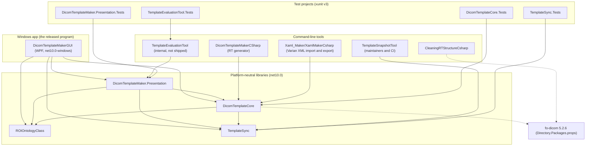
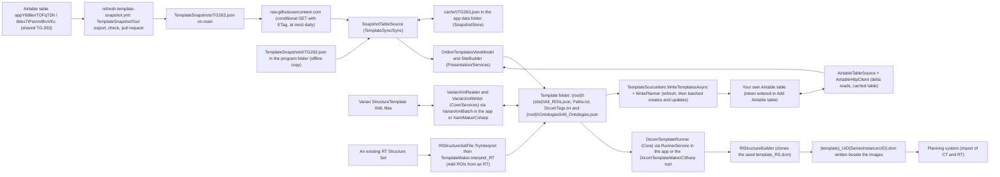
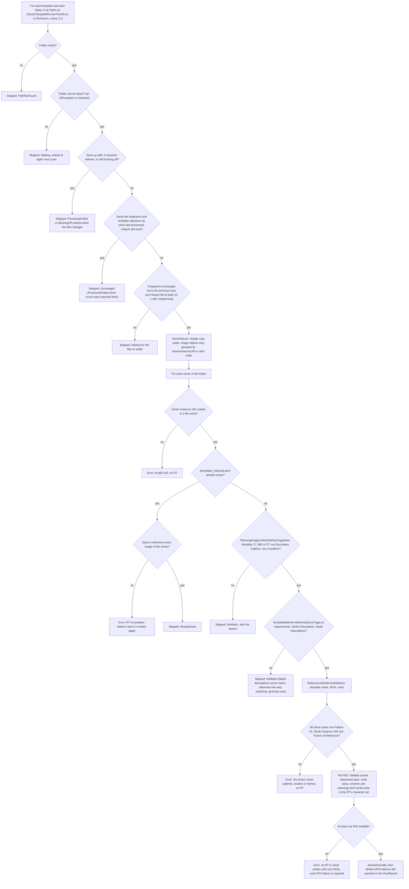
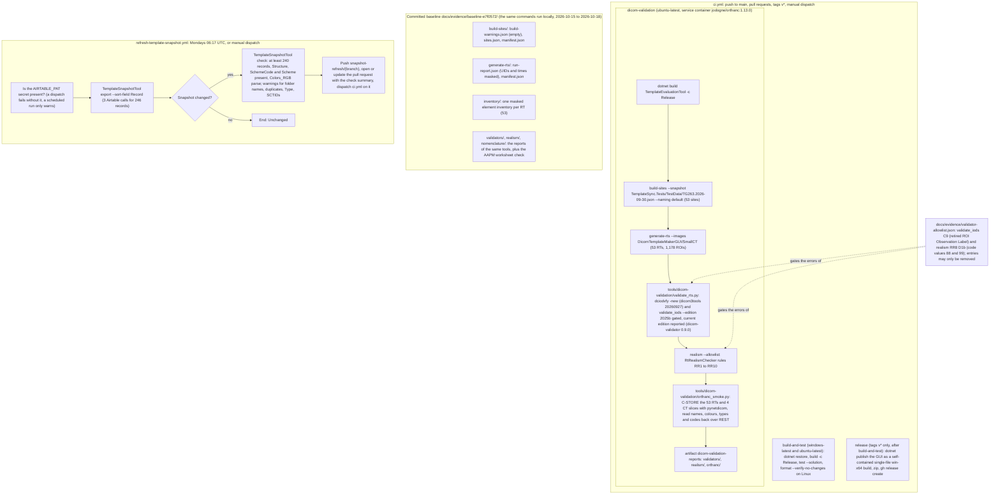
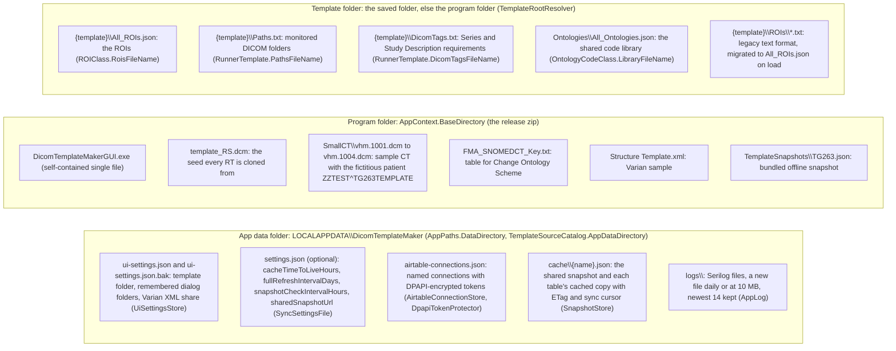

# Architecture

How DicomTemplateMakerCSharp works, as five Mermaid diagrams with one paragraph each. Every node is a
project, a file, a class or a workflow step of this repository at `08eca39` (2026-11-03). Companion
documents: `README.md` (what the program does), `docs/STATUS.md` (where the overhaul stands),
`docs/EVALUATION_PROTOCOL.md` (the evidence procedures).

## 1. Components and dependencies

The arrows are the `ProjectReference` entries of the csproj files. `DicomTemplateMakerGUI` is the only
Windows-only project; its code-behind shows what `DicomTemplateMaker.Presentation` decides (view models,
rules such as `NameRules` and `AddRoiRules`, the `RunnerService`, confirmations in `ShellMessages` and
`EditorMessages`, settings in `UiSettingsStore`). `DicomTemplateCore` holds the RT generator
(`DicomTemplateServices/`), the template logic and the Varian XML reader and writer (`Services/`) and the
TPS-realism checker (`Validation/`); it depends on `ROIOntologyClass` (the `ROIClass` and
`OntologyCodeClass` data model and template-folder files) and on `TemplateSync` (Airtable client, snapshot
and cache, write planner, encrypted connection store), because `TemplateEntryMapper` maps Airtable rows to
ROIs. Three command-line tools sit on `DicomTemplateCore` or `TemplateSync`; `TemplateEvaluationTool`
sits on the Presentation library because it drives the same `SiteBuilder` the window uses.
`CleaningRTStructureCsharp` references only fo-dicom. All four test projects run on any OS; the WPF
project is compile-checked on Linux through `EnableWindowsTargeting`.

## 2. Data flow

Templates reach the program by three routes and leave it by two. The shared TG-263 table is never read
by the program directly: the weekly workflow exports it to `TemplateSnapshots/TG263.json`, the program
downloads that file over HTTPS with an ETag (`SnapshotTableSource`, at most once a day or on Refresh),
keeps it in `cache\` and falls back to the copy bundled with the release, so browsing the shared templates
costs no Airtable calls. A user's own table goes through `AirtableTableSource`, which pages the table once,
then fetches only changed records (`TableFetcher`, `filterByFormula`) and keeps the result in the same
cache; writes go back through `WritePlanner` in batches of ten after a refresh. Both sources feed
`OnlineTemplatesViewModel`, whose `SiteBuilder` writes one template folder per site (`All_ROIs.json` plus
`Paths.txt` and `DicomTags.txt`, and the shared code library `Ontologies\All_Ontologies.json`). The
generator (`DicomTemplateRunner`) reads those folders and writes one RT Structure Set per planning series
next to the images, which the planning system imports with the CT. The side path converts template folders
to and from Varian StructureTemplate XML (`VarianXmlReader`, `VarianXmlWriter`); the reverse path builds a
template from an existing RT's ROI names, colours, types and codes (`RtStructureSetFile.TryInterpret`).

## 3. The generator's decisions for one series

`DicomTemplateRunner` (`DicomTemplateCore/DicomTemplateServices/DicomTemplateRunner.cs`) visits every
folder named in every template's `Paths.txt` once per cycle and records each outcome in a `RunReport`
(written RTs, skipped folders and series with a `SkipReason`, ROI failures, errors), which the app's status
line and log and the command-line tool's exit code are built from. A folder is only read when its files
have stopped changing (`DirectoryFingerprint`: names, sizes and last-write times, generated RTs excluded)
and its newest file is at least `SettleTime` old; a folder that fails with a transient I/O error is retried
with back-off up to five times and then until its files change. `DicomParser` reads headers only and groups
image objects by `SeriesInstanceUID`, so every series in a folder is decided on its own. An RT that already
exists is never replaced, but one that does not reference every image of its series is reported as
incomplete. `PlanningImages` and `TemplateMatcher` decide whether a series gets an RT at all;
`RtStructureBuilder` then clones `template_RS.dcm`, copies the patient and study attributes from that
series only (missing ones written empty), gives the RT new UIDs and writes one Structure Set ROI, ROI
Contour and RT ROI Observations item per ROI whose name, type and code are complete and encodable. The
file is written to a temporary name and moved into place.

## 4. CI and evidence

Three jobs and one more workflow produce the evidence. `build-and-test` is the gate every pull request
must pass (warnings are errors, formatting is checked on Linux). `dicom-validation` rebuilds the 53 TG-263
sites from the frozen fixture, not from the live snapshot, generates one RT per site on the sample CT and
runs two independent validators, the realism rules and an Orthanc transfer; an error passes only when an
entry of `docs/evidence/validator-allowlist.json` names the conformance gap (C-id) or pending decision that
explains it, and the allowlist may only shrink. The `release` job runs only for a `v*` tag and has not run
yet; it warns, but does not fail, when the bundled snapshot is missing. The committed baseline under
`docs/evidence/baseline-e7f0572/` was produced by the same commands locally and is what any later change
to RT content is diffed against; its inventories mask UIDs, dates, times and every patient attribute so
they can be committed. The snapshot workflow is the only thing that spends Airtable quota (three calls a
week); a changed export is proposed as a pull request from `snapshot-refresh/<branch>` rather than pushed.

## 5. Runtime file layout

The program writes user state only under `%LOCALAPPDATA%\DicomTemplateMaker`: window settings
(`ui-settings.json`, copied to `.bak` before a damaged one is replaced), the optional online-template
settings, the encrypted Airtable connections (the `AIRTABLE_PAT` environment variable overrides every stored
token), the snapshot and table caches, and the logs. It reads its data files from its own folder, never from
the working directory; the five files listed there are copied next to the exe by the GUI csproj and kept
outside the single-file bundle so they can be opened by path. Templates live in the template folder shown
in the main window: one sub-folder per template with the three files above, plus the shared `Ontologies`
library at the root; a template whose `All_ROIs.json` is missing is migrated from the legacy `ROIs\*.txt`
files, and files that fail to parse are never deleted or saved over. The evaluation tool never touches the
app data folder: every command takes `--data-dir` or writes only under its `--out` folder.
